# PR Receipt — what did this pull request cost in AI tokens?

## Live

**https://pr-receipt.1426davejobs.workers.dev**

The website runs on a Cloudflare Worker, static assets on the free plan, since 2026-11-08: Vercel's account is blocked, so pr-receipt.vercel.app answers 402. These screenshots are of the live Worker, taken with Playwright in Chrome. The CLI itself runs on your machine.

| | Desktop (1440×900) | Phone (390×844) |
|---|---|---|
| The landing page: what PR Receipt does, with a sample receipt |  | 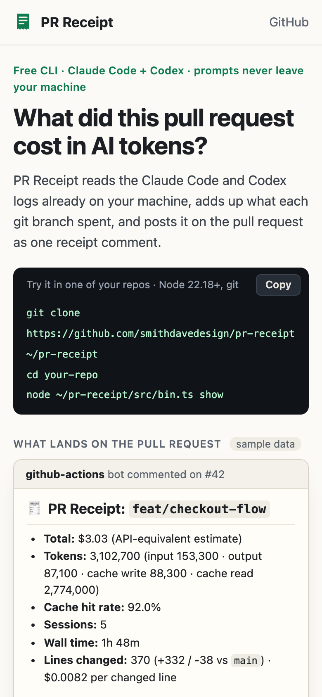 |
| The core action: Copy puts the try-it command on the clipboard (Team Pack isn't on sale yet) | 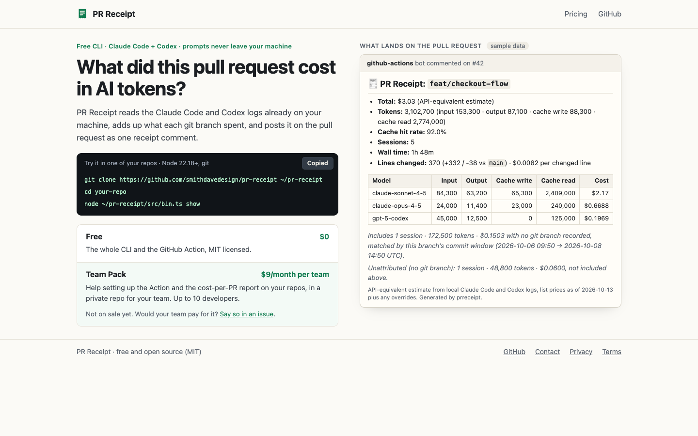 | 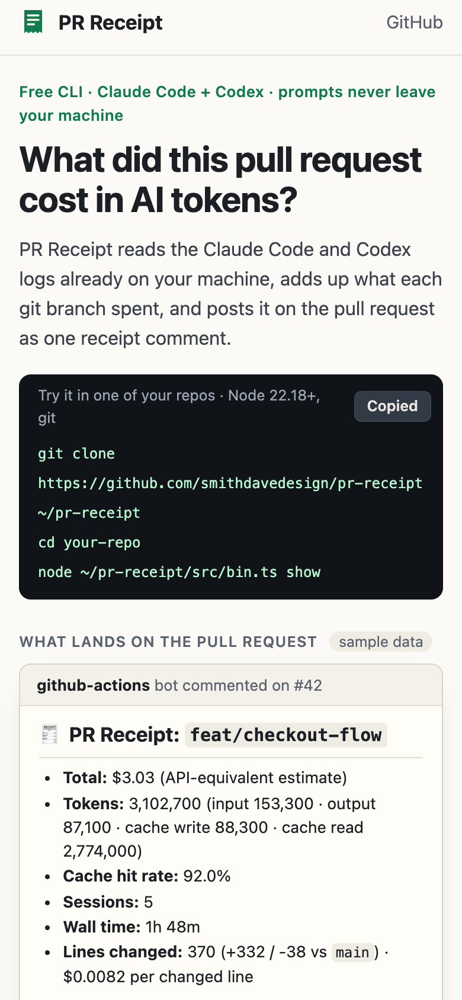 |
| The privacy page: the three anonymous visit events, and who hosts the site | 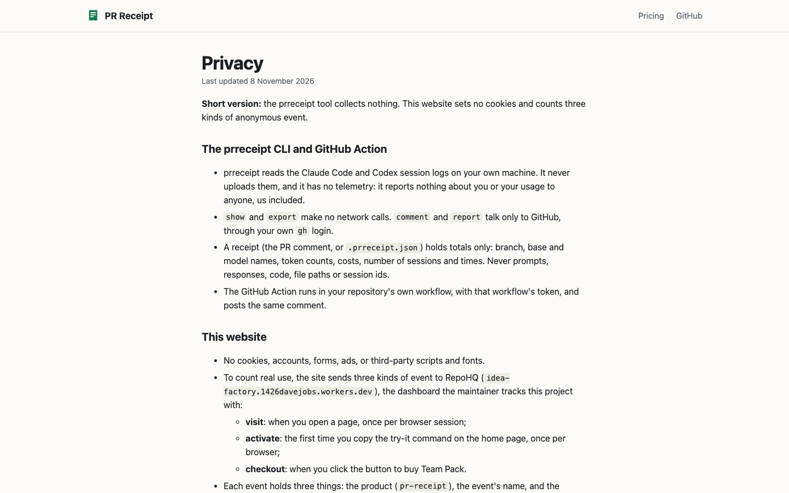 | 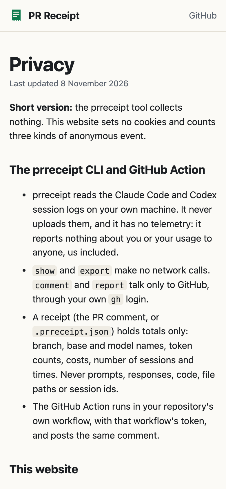 |

## Screenshots

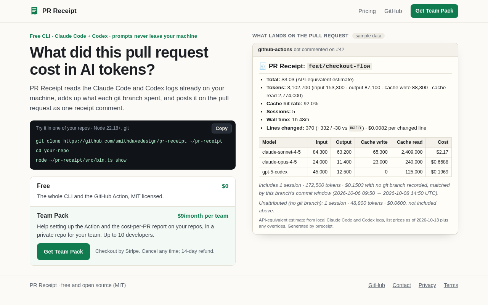
The launch site, production build, with a placeholder payment link: the Buy button ("Get Team Pack"), the real sample receipt, and Privacy and Terms in the footer, all in one 1280×800 view.

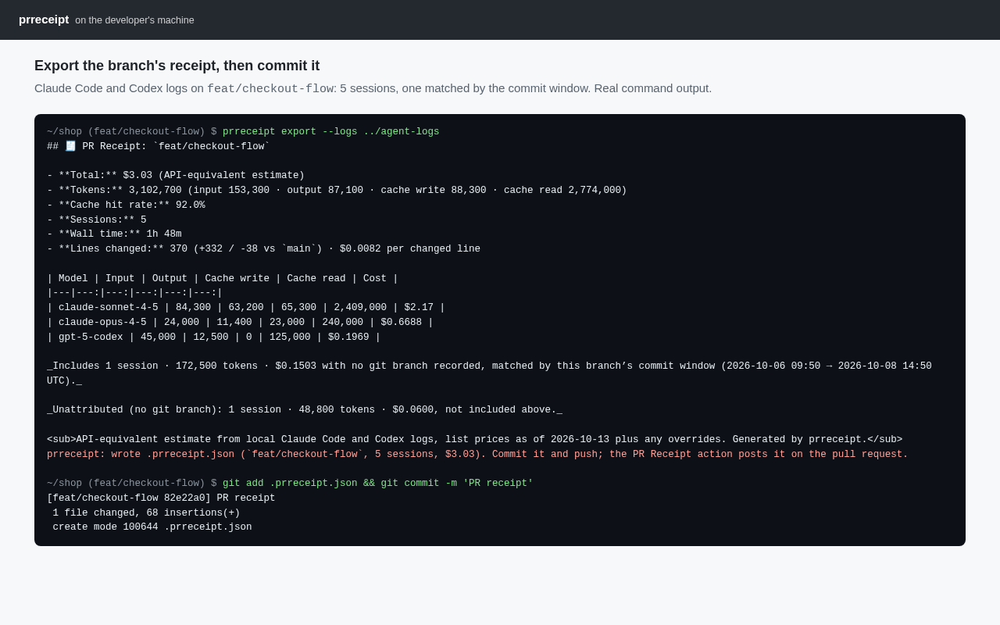
The core action, run for real: `prreceipt export` reads sample Claude Code and Codex logs for `feat/checkout-flow` and prints the receipt ($3.03, 5 sessions, $0.0082 per changed line), then `.prreceipt.json` is committed.

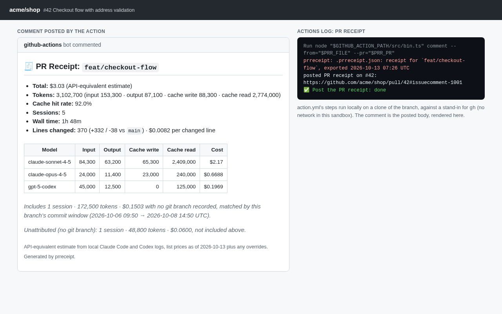
The result: `action.yml`'s steps ran on a clone of that branch and posted the same receipt as one PR comment (`gh` was a local stand-in, since this sandbox has no network).

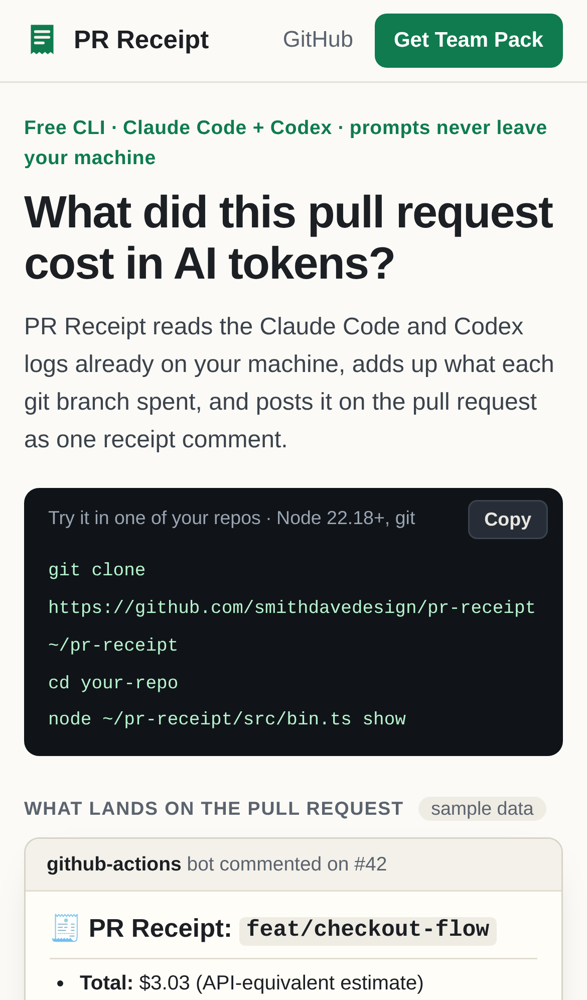
On an iPhone 13 the site stacks into one column, with the Buy button kept in the top bar.

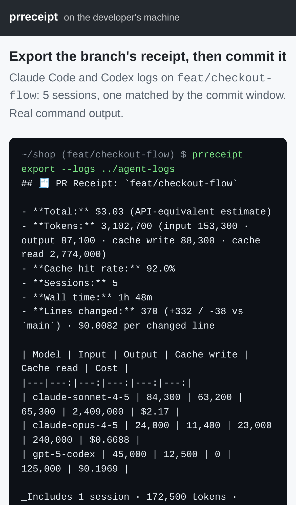
The same `export` run on a phone viewport: the output wraps and stays readable.

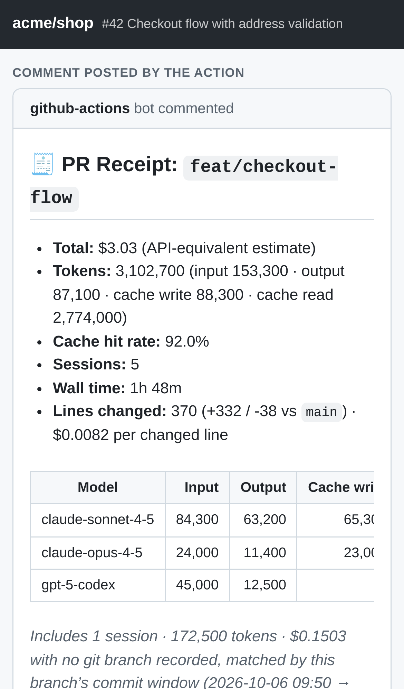
The posted comment on a phone; the model table scrolls sideways as it does on GitHub.

Regenerate all six with `npm run screenshots` (needs `CHROMIUM_PATH`; not part of `npm test`).

For developers and leads running Claude Code/Codex on metered billing, it attributes local agent token spend to each git branch and posts a cost receipt on the pull request.

```sh
prreceipt show                 # this branch's receipt, from local Claude Code + Codex logs
prreceipt comment              # post it on the branch's PR via gh (updates the same comment next time)
prreceipt export               # or write .prreceipt.json, commit it, and let the GitHub Action post it
prreceipt report --since 30d   # cost per merged PR: total, median, top 5
```

### Post receipts from CI

Copy [`examples/prreceipt-workflow.yml`](examples/prreceipt-workflow.yml) to `.github/workflows/prreceipt.yml`.
On your machine, run `prreceipt export` on the PR's branch and commit `.prreceipt.json`. The action
([`action.yml`](action.yml), `uses: smithdavedesign/pr-receipt@main`) posts that receipt as one comment on
the pull request and updates it after each new export. CI never sees your agent logs; the file holds totals
only.

### Website

[`site/`](site/) is the public site: home, [privacy](site/pages.ts) and terms, plus robots.txt, sitemap.xml and a
share image drawn in code. It's static and has no dependencies. `npm run site:build` writes `site/out/`, and
`npm run site:serve` shows it on http://127.0.0.1:4173. Vercel builds it with [`vercel.json`](vercel.json); since
2026-11-08 it's served by a Cloudflare Worker (below). The Buy button appears only when `STRIPE_PAYMENT_LINK` is set at
build time. Launch notes:
[LAUNCH-READY.md](LAUNCH-READY.md).

- [Research](RESEARCH.md) — findings and sources
- [PRD](PRD.md)
- [Roadmap](ROADMAP.md)
- [Build notes](BUILD.md): what works now and how to run and test it.
  - M1: `prreceipt show [branch]`.
  - M2: `prreceipt comment`, which posts or updates one receipt comment on the PR via `gh`, with $ per
    changed line and commit-window attribution.
  - M3: Codex logs alongside Claude Code, and `prreceipt report --since 30d` with the cost per merged PR,
    the median and the top 5.
  - M4: `prreceipt export` → `.prreceipt.json` → the GitHub Action posts it.

Effort: Low · Confidence: Medium

_Researched by the idea pipeline on 2026-10-10 ([original record](https://github.com/smithdavedesign/idea-factory/tree/main/ideas/pr-receipt)); repo created on David's go-ahead 2026-10-11._

## Hosting on Cloudflare Workers

Since 2026-11-08 the website is served by the `pr-receipt` Worker on Cloudflare (free plan): static assets only, no
Worker code. [`wrangler.jsonc`](wrangler.jsonc) serves `site/out/` with `html_handling: auto-trailing-slash`
(`/privacy` → `privacy.html`, like Vercel's `cleanUrls`). Vercel ignores `wrangler.jsonc`, so both hosts build from the
same code.

```bash
npm run cf:build                                 # site/out, counted as production, plus site/out/_headers (vercel.json's CSP)
provision cloudflare deploy pr-receipt "$PWD"    # deploy with the credential broker (token from the keychain)
provision cloudflare url pr-receipt              # https://pr-receipt.1426davejobs.workers.dev
```

`cf:build` sets `NEXT_PUBLIC_DEPLOY_ENV=production`, stamped on `<html data-env>`, so the visit beacon counts the
Worker's visitors (on Vercel it's `VERCEL_ENV`). Canonical and share URLs default to the Worker's address; set
`SITE_URL` to pin a custom domain. No `STRIPE_PAYMENT_LINK` is stored for pr-receipt, so the Buy button stays hidden.
