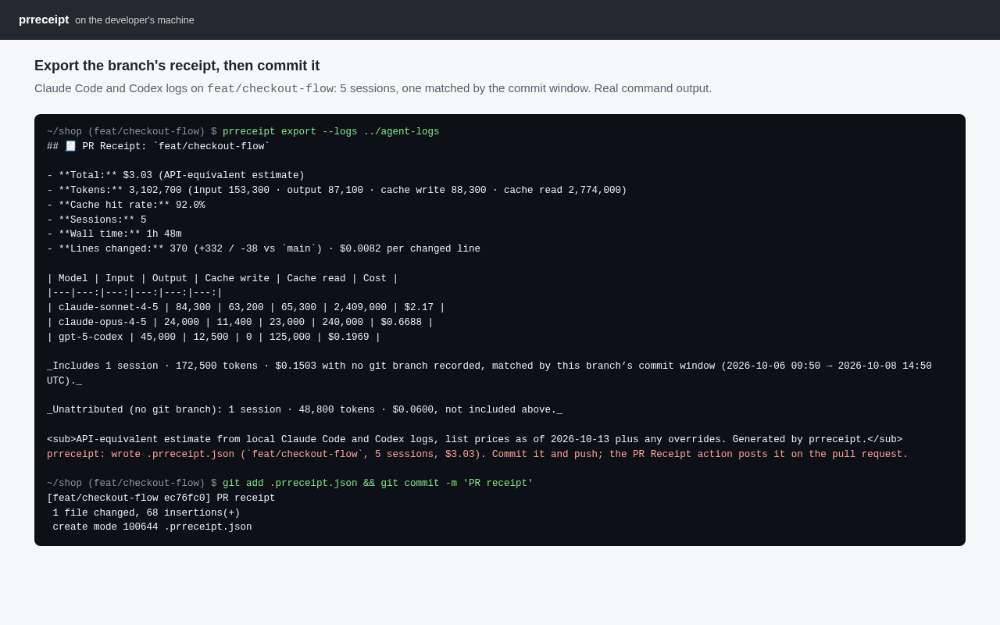
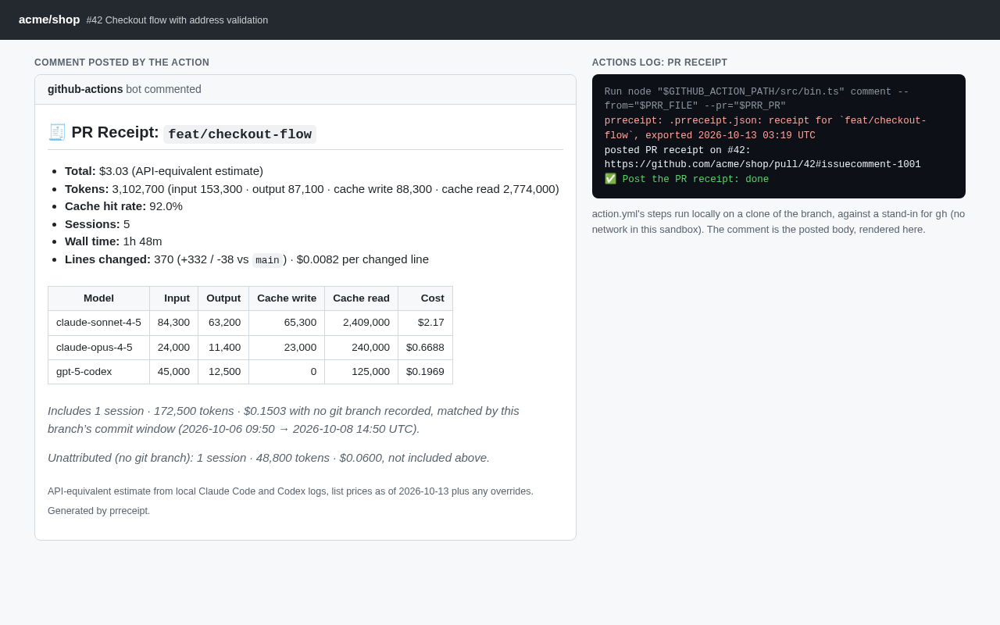
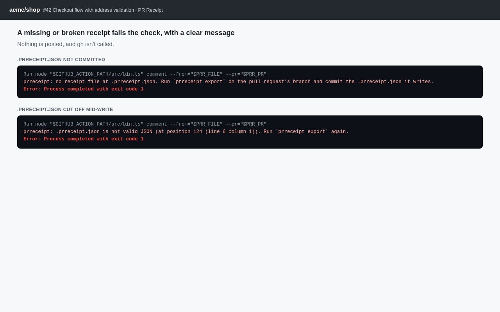
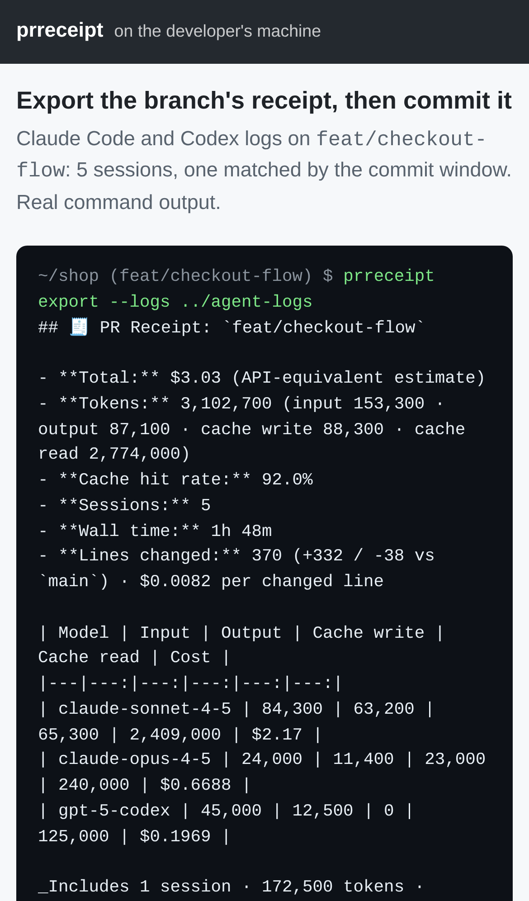
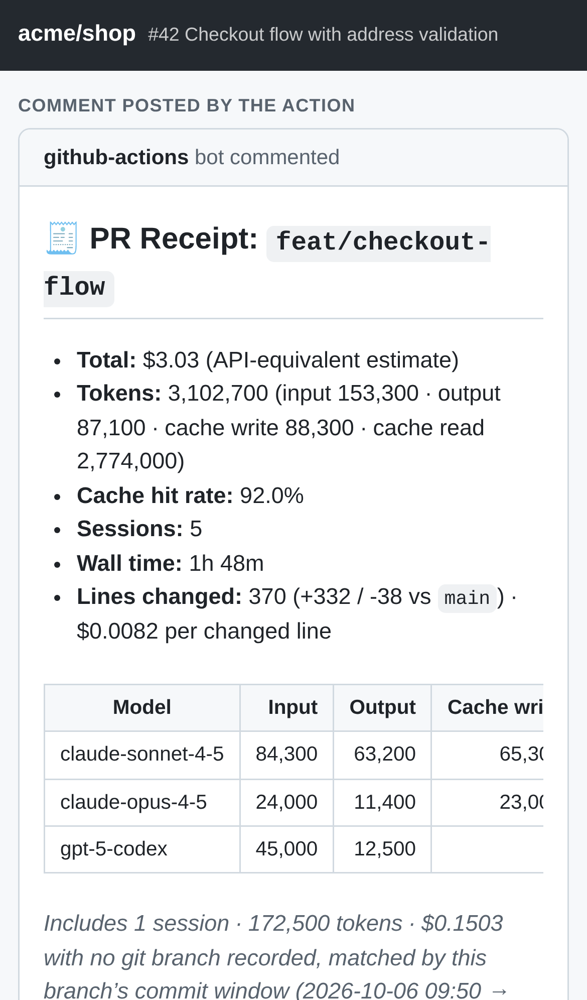
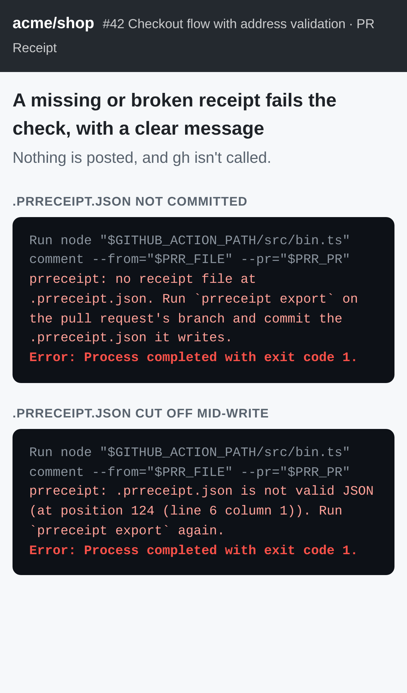

# PR Receipt — what did this pull request cost in AI tokens?

## Screenshots


`prreceipt export` reads sample Claude Code and Codex logs for `feat/checkout-flow` and prints the receipt: $3.03, 5 sessions, $0.0082 per changed line. It writes `.prreceipt.json`, which is then committed.


The steps in `action.yml` ran on a clone of that branch and posted the same receipt as one PR comment. `gh` was a local stand-in, since this sandbox has no network.


A missing or broken receipt file fails the step with exit code 1 and a message that says what to do. Nothing is posted.




The same three pages on an iPhone 13 viewport. Regenerate them with `npm run screenshots`, which needs `CHROMIUM_PATH`.

For developers and leads running Claude Code/Codex on metered billing, it attributes local agent token spend to each git branch and posts a cost receipt on the pull request.

```sh
prreceipt show                 # this branch's receipt, from local Claude Code + Codex logs
prreceipt comment              # post it on the branch's PR via gh (updates the same comment next time)
prreceipt export               # or write .prreceipt.json, commit it, and let the GitHub Action post it
prreceipt report --since 30d   # cost per merged PR: total, median, top 5
```

### Post receipts from CI

Copy [`examples/prreceipt-workflow.yml`](examples/prreceipt-workflow.yml) to `.github/workflows/prreceipt.yml`.
On your machine, run `prreceipt export` on the PR's branch and commit `.prreceipt.json`. The action
([`action.yml`](action.yml), `uses: smithdavedesign/pr-receipt@main`) posts that receipt as one comment on
the pull request and updates it after each new export. CI never sees your agent logs; the file holds totals
only.

- [Research](RESEARCH.md) — findings and sources
- [PRD](PRD.md)
- [Roadmap](ROADMAP.md)
- [Build notes](BUILD.md): what works now and how to run and test it.
  - M1: `prreceipt show [branch]`.
  - M2: `prreceipt comment`, which posts or updates one receipt comment on the PR via `gh`, with $ per
    changed line and commit-window attribution.
  - M3: Codex logs alongside Claude Code, and `prreceipt report --since 30d` with the cost per merged PR,
    the median and the top 5.
  - M4: `prreceipt export` → `.prreceipt.json` → the GitHub Action posts it.

Effort: Low · Confidence: Medium

_Researched by the idea pipeline on 2026-10-10 ([original record](https://github.com/smithdavedesign/idea-factory/tree/main/ideas/pr-receipt)); repo created on David's go-ahead 2026-10-11._
